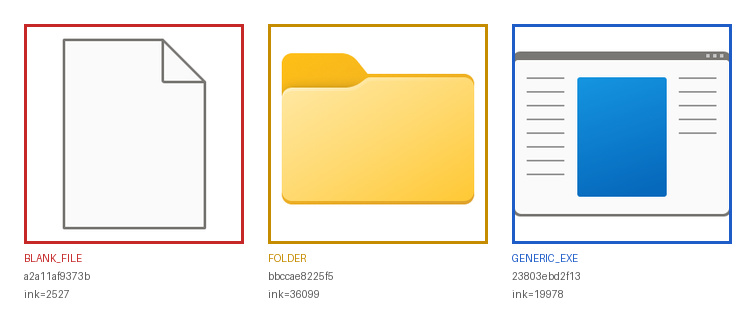

# windows-icon-repair

Diagnose and fix Windows icons that turned into a blank page, a plain folder, or
the generic "application window" glyph — and the separate, much more confusing
case where a *pinned running app* shows the wrong icon while its shortcut looks
perfectly fine.

Pure Python + `ctypes`. No `pywin32`, no `comtypes`, no WScript.Shell, no
external binaries.

```
python scripts/selftest.py                     # is the detector still accurate here?
python scripts/diag_icons.py --csv scan.csv    # what is actually broken
python scripts/contact_sheet.py --only-bad --out bad.png   # see it
python scripts/fix.py --remap "C:\Old=C:\New"  # dry run
python scripts/fix.py --remap "C:\Old=C:\New" --apply --backup .\bak
python scripts/refresh_shell.py                # make Explorer notice
```

## Why an icon goes blank

An icon is not a stored attribute. It is the *result* of a fallback chain, and it
comes out blank when every link fails. Shortcuts and taskbar buttons walk two
**different** chains:

| Shown in | Chain |
|---|---|
| Desktop / Start menu | `IconLocation` → target exe's resource → file-type association → generic glyph |
| Running taskbar button | registered AUMID `IconUri` → window's `RelaunchIconResource` → cached implicit shortcut → generic glyph |

A running button never reads the pinned `.lnk`. That single fact explains most
"but I already fixed the shortcut" reports, and it is why this repo measures
both.

## What the four glyphs mean



| Glyph | Class | Cause |
|---|---|---|
| White sheet of paper | `BLANK_FILE` | nothing resolvable at all |
| Yellow folder | `FOLDER` | target is a directory, or the exe is gone |
| Card + blue window | `GENERIC_EXE` | exe exists but has no icon resource |
| Generic icon while running | AUMID bug | the window's AUMID chain is broken |

`Saves.lnk` pointing at a folder is **correct**. A website `.url` with no icon
rendering as a blank page is **correct**. Both are reported, neither is a bug.

## Scripts

| Script | Purpose |
|---|---|
| `icore.py` | render any file's icon at 256x256 via `IShellItemImageFactory`; classify against measured baselines |
| `lnk.py` | read/write `.lnk` (IShellLink + IPersistFile), `.url` INI files, and `.lnk` AUMID properties |
| `diag_icons.py` | scan the five shell roots, classify every shortcut, CSV out |
| `selftest.py` | prove the classifier still detects each failure shape, and measure false positives |
| `fix.py` | dry-run/apply repairs: path remaps, icon assignment, `.url` icons, with backups + re-read verification |
| `contact_sheet.py` | render a labelled contact sheet for human review |
| `aumid.py` | inspect a live window's AUMID chain; register an AppUserModelId |
| `make_ico.py` | build a multi-size `.ico` from an image or an exe's icon |
| `refresh_shell.py` | `SHChangeNotify` → `ie4uinit -show` → optional cache purge + Explorer restart |

All scripts are standalone and importable; `python <script> --help` documents
the flags.

## Design decisions worth knowing

**Measure baselines at runtime.** The generic glyphs differ across Windows
builds and themes. Hardcoded hashes produce confident wrong answers, so
`icore.baselines()` renders three real temporary files and hashes those.

**Two criteria, not one.** A pixel-difference test alone reported a real 7-Zip
icon as blank, because both images are mostly whitespace. A candidate must
*differ* from a baseline **and** have an ink bounding box close to it; anything
ambiguous is reported `OK`. Under-reporting beats crying wolf.

**Never write a guess.** A remap rule applies only when the rewritten path
exists, so a wrong hypothesis is skipped instead of corrupting the shortcut.

**Re-read after every write.** `IPersistFile::Save` can succeed and leave a
field stale. Every changed field is read back and compared.

**Backup or refuse.** `--apply` exits with code 2 unless `--backup` is given.

## Requirements

- Windows 10 or 11
- Python 3.8+
- Pillow (`pip install pillow`)

## Documentation

- `references/01-triage.md` — telling the four shapes apart, and the traps that
  invent fake breakage
- `references/02-dead-targets.md` — directory renames, remap rules, registry
  and service fallout
- `references/03-icon-location.md` — `IconLocation` semantics and the `.url`
  field-ordering bug
- `references/04-taskbar-aumid.md` — the AUMID chain and the implicit shortcut
  cache
- `references/05-permissions-and-cache.md` — `%ProgramData%` ownership,
  elevation, the three caches
- `references/06-verification.md` — what counts as proof, and how to report
  an unfixable case honestly

## Scope and safety

`fix.py` **only edits shortcuts** — it never writes registry values, even though
the references document how a directory rename also corrupts `Uninstall` keys,
`App Paths` and service `ImagePath`. Those need a separate, reviewed pass; doing
them inside an icon tool would be too broad an action to run by accident. Keep
the scope narrow, then re-run `diag_icons.py` to confirm the count dropped.

Read the dry-run output before applying, and keep the backup directory.

## License

MIT — see `LICENSE`.
